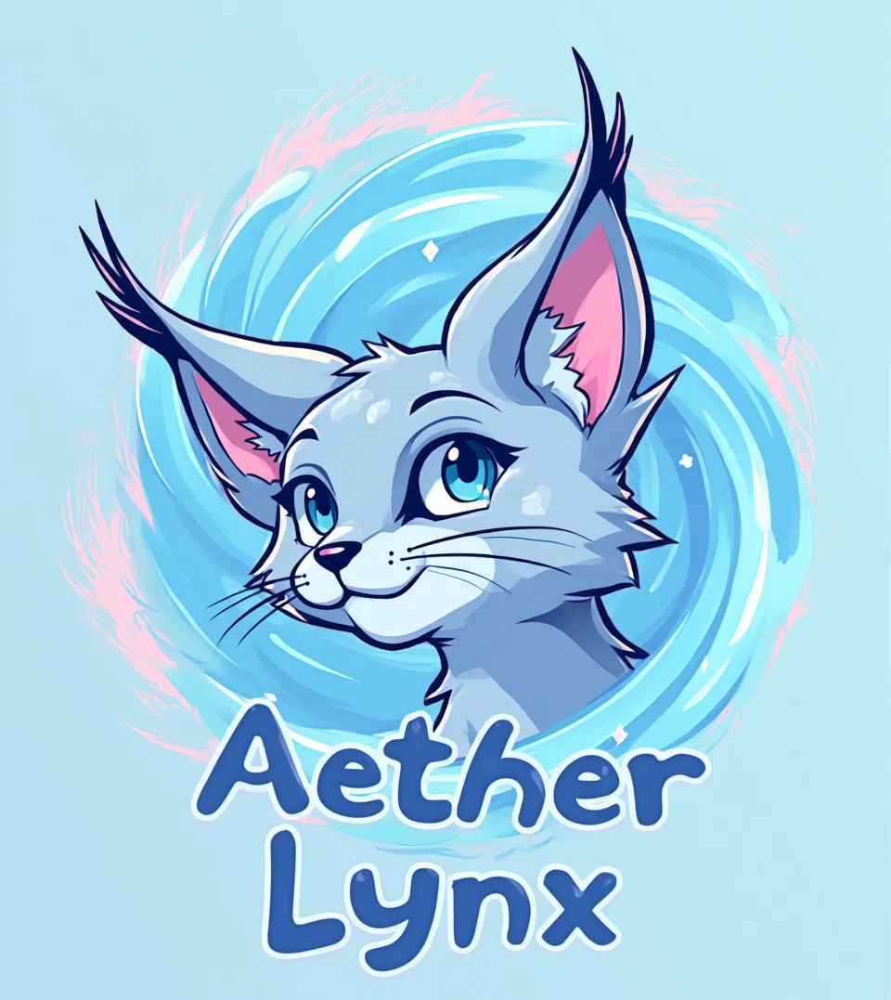

# AetherLynx SDK



AetherLynx SDK orquesta agentes de modelos de lenguaje (LLM) con un enfoque declarativo inspirado en Kubernetes: usted declara cuántas réplicas quiere de cada agente y un reconciliador hace converger el estado real hacia ese objetivo.

## Componentes

| Componente | Ruta | Qué hace |
|---|---|---|
| Orquestador | `agent_system/` | Servidor gRPC + reconciliador. Guarda el estado deseado de cada agente y pide al *runtime* que converja. |
| CLI | `cli/` | `aetherlynx-cli`: crea, escala, lista y elimina agentes; consulta el estado. |
| API compartida | `proto/aetherlynx.proto` | Contrato gRPC único para servidor y CLI. |
| Agente de consultas | `agents/` | Agente de ejemplo que responde preguntas de estudiantes con datos académicos y financieros minimizados. |
| Auth (PAM/IPA) | `tools/pam_ipa_project/` | Autenticación con Argon2id + JWT y autorización por roles, en Rust con API FastAPI. |
| Vault | `tools/vault/` | Almacén de secretos AES-256-GCM con clave derivada por Argon2id. |
| Telemetría | `telemetry/` | `aetherlynx-telemetry`: colector OpenTelemetry propio (OTLP/HTTP), almacenamiento SQLite, alertas y panel web. |
| Despliegue | `kubernetes/`, `scripts/` | Manifiestos endurecidos y script de despliegue. |

> **Runtimes.** El orquestador decide *qué* debe existir; el runtime lo hace existir. Hay dos: `simulated` (por defecto) mantiene las réplicas en memoria, para desarrollo y pruebas; `kubernetes` crea un Deployment y un Service por agente en un clúster. Vea [Runtime de Kubernetes](#runtime-de-kubernetes).

## Requisitos

- Rust **1.88** o superior y `protoc` (`apt install protobuf-compiler` / `brew install protobuf`)
- Python **3.9** o superior; `maturin` para compilar los módulos de `tools/`

## Inicio rápido

```bash
git clone https://github.com/jclanas2019/AetherLynxSDK.git
cd AetherLynxSDK
cargo build --release

# El orquestador exige un token de al menos 32 caracteres
export AETHERLYNX_API_TOKEN="$(python3 -c 'import secrets; print(secrets.token_urlsafe(32))')"
./target/release/aetherlynx-orchestrator start
```

En otra terminal, con el mismo `AETHERLYNX_API_TOKEN`:

```bash
aetherlynx-cli agent create --name student-agent --model gpt-4o --replicas 3
aetherlynx-cli agent scale  --name student-agent --replicas 5
aetherlynx-cli agent list
aetherlynx-cli orchestrator status
aetherlynx-cli agent delete --name student-agent
aetherlynx-cli agent list -o json      # salida para scripts
```

Opciones útiles del orquestador (`aetherlynx-orchestrator start --help`):

| Opción | Variable | Por defecto |
|---|---|---|
| `--listen` | `AETHERLYNX_LISTEN` | `127.0.0.1:50051` |
| `--api-token` | `AETHERLYNX_API_TOKEN` | obligatorio |
| `--tls-cert`, `--tls-key` | `AETHERLYNX_TLS_CERT`, `AETHERLYNX_TLS_KEY` | sin TLS |
| `--runtime simulated\|kubernetes` | `AETHERLYNX_RUNTIME` | `simulated` |
| `--reconcile-interval` | | `5s` |
| `--integration-url` | `AETHERLYNX_INTEGRATION_URL` | desactivada |
| `--log-format text\|json` | `AETHERLYNX_LOG_FORMAT` | `text` |

La CLI lee `AETHERLYNX_ENDPOINT` (por defecto `http://127.0.0.1:50051`), `AETHERLYNX_API_TOKEN` y, para TLS con CA propia, `AETHERLYNX_CA_CERT`.

## Modelo de seguridad

- **Autenticación obligatoria.** Sin token el orquestador no arranca. `--allow-unauthenticated` existe solo para desarrollo y solo en loopback.
- **Sin texto plano en la red.** Escuchar fuera de loopback exige TLS (`--tls-cert`/`--tls-key`), salvo que se indique `--allow-insecure-transport` porque un service mesh ya cifra el tráfico.
- **Entradas validadas.** Nombres de agente con formato DNS-1123 (hasta 52 caracteres, para que `aetherlynx-<nombre>` sea un nombre válido en Kubernetes), modelos con caracteres acotados y réplicas entre 0 y 100. Nada sin validar llega al estado ni a los logs.
- **Fallar en voz alta.** Si el servidor gRPC no puede arrancar, el proceso termina con error.
- **Datos personales.** El agente de consultas solo envía al LLM una lista explícita de campos no identificativos. Vea `agents/student_queries_agent.py`.

## Herramientas

- [Auth PAM/IPA](tools/pam_ipa_project/README.md)
- [Vault](tools/vault/README.md)

## Agente de consultas

```bash
cd agents
pip install -r requirements.txt
export UNIVERSITY_API_URL=https://api.university.edu UNIVERSITY_API_TOKEN=... OPENAI_API_KEY=...
python student_queries_agent.py 12345 "¿Cuándo puedo inscribir ramos para el próximo semestre?"

# como servicio HTTP (el modo que usa Kubernetes)
export AETHERLYNX_AGENT_TOKEN="$(python3 -c 'import secrets; print(secrets.token_urlsafe(48))')"
uvicorn service:app --port 5000
```

## Runtime de Kubernetes

Con `--runtime kubernetes`, cada agente es un **Deployment** y un **Service** llamados `aetherlynx-<agente>` en el namespace del orquestador:

```bash
aetherlynx-orchestrator start --runtime kubernetes \
  --agent-image registry.example.com/aetherlynx/university-agent:0.4.0
aetherlynx-cli agent create --name student-agent --model gpt-4o-mini --replicas 3
kubectl -n aetherlynx get deploy,svc -l app.kubernetes.io/managed-by=aetherlynx-orchestrator
```

Cómo funciona:

- **Server-side apply** con el gestor de campos `aetherlynx-orchestrator`. Cada ciclo es idempotente: si nada cambió, Kubernetes no registra ninguna escritura.
- **«Ready» significa rollout terminado**: generación observada al día y todas las réplicas actualizadas y listas. Un rollout atascado (`ProgressDeadlineExceeded`) o un error de cuota marcan el agente como `Failed` con el mensaje de Kubernetes.
- **El estado vive en el clúster.** Al arrancar, el orquestador lista sus Deployments (por etiquetas de propiedad) y reconstruye el registro, así que un reinicio no pierde agentes. En cada ciclo retira los Deployments suyos que ya no correspondan a ningún agente.
- **Borrado limpio.** `agent delete` borra el Deployment en primer plano y espera a que desaparezca; el Service se va con él (`ownerReferences`).
- **Pods endurecidos**, igual que los manifiestos: sin root, sistema de archivos de solo lectura, sin capacidades, seccomp, límites, sondas y el modelo del agente en `AETHERLYNX_LLM_MODEL`. Cumplen el perfil Pod Security «restricted».
- **Nunca toca lo ajeno.** Antes de aplicar o borrar, comprueba las etiquetas de propiedad del objeto (gestor e instancia). Si ya existe un `aetherlynx-<agente>` que no es suyo (por ejemplo, el propio Deployment del orquestador si alguien crea un agente llamado `orchestrator`), el agente queda en `Failed` con un mensaje claro y el objeto no se modifica. Los borrados llevan precondición de `uid`.
- **Borrados que sobreviven a reinicios.** Antes de borrar, marca el Deployment con la anotación `aetherlynx.io/deleting`. Si el orquestador se reinicia a mitad, no recupera ese agente y la limpieza termina el borrado. La limpieza **solo** borra lo que tiene esa marca: un Deployment que no pudo recuperar (por ejemplo, sin la anotación de modelo) se deja intacto y se avisa en el log.
- **El orquestador manda en lo que declara.** Usa server-side apply con `force`: si alguien cambia las réplicas con `kubectl scale` o un HPA, el siguiente ciclo las devuelve a lo pedido. Escale con la CLI.
- **Instancias.** `--instance` separa la propiedad, pero los nombres de objeto no la incluyen: dos instancias en el mismo namespace no pueden tener un agente con el mismo nombre (la segunda recibe un error, no pisa a la primera). Lo más simple es un namespace por orquestador.
- **Carga en el API.** Se reconcilian hasta 8 agentes a la vez. En régimen estable, cada agente cuesta un GET y un PATCH (que no escribe si nada cambió) por ciclo, más un LIST por ciclo para la limpieza. Con muchos agentes, suba `--reconcile-interval`.

Opciones (`aetherlynx-orchestrator start --help`, sección «Runtime de Kubernetes»): `--agent-image` (obligatoria), `--k8s-namespace`, `--instance`, `--agent-secret`, `--agent-configmap`, `--agent-service-account` y los recursos `--agent-cpu-request`, `--agent-memory-request`, `--agent-memory-limit`. Fuera del clúster usa `KUBECONFIG` o `~/.kube/config`, y respeta `HTTPS_PROXY`/`NO_PROXY`.

Para ver lo que se aplicaría sin tocar el clúster (el Service se muestra sin `ownerReferences`, que dependen del uid real del Deployment; `kubectl diff` mostrará esa diferencia):

```bash
aetherlynx-orchestrator render-agent --name student-agent --model gpt-4o-mini --replicas 3 \
  --agent-image registry.example.com/aetherlynx/university-agent:0.4.0 | kubectl diff -f -
```

## Despliegue en Kubernetes

```bash
docker build -t <registro>/aetherlynx/university-agent:0.4.0 agents/
docker build -f Dockerfile.orchestrator -t <registro>/aetherlynx/orchestrator:0.4.0 .
docker build -f Dockerfile.telemetry -t <registro>/aetherlynx/telemetry:0.4.0 .
# cree los secretos según kubernetes/examples/ y ajuste las imágenes en los manifiestos
scripts/deploy_k8s.sh --orchestrator --dry-run
scripts/deploy_k8s.sh --orchestrator      # orquestador: un Deployment por agente
scripts/deploy_k8s.sh --orchestrator --telemetry   # ...y el colector de telemetría
scripts/deploy_k8s.sh                     # o bien: agente estático con réplicas fijas
```

Elija uno de los dos modos: con `--orchestrator` no aplique `agent-deployment.yaml`.

- **Orquestador** (`kubernetes/orchestrator.yaml`): una sola réplica con estrategia `Recreate` (el reconciliador no tiene elección de líder) y un Role limitado a Deployments y Services de su namespace. Poder crear Deployments permite lanzar pods que monten cualquier Secret del namespace, así que dedique el namespace a AetherLynx. Exige el Secret `orchestrator-secrets` (token del API) y el Secret TLS `orchestrator-tls`; sin token o sin TLS no arranca. Use `--allow-insecure-transport` solo si un service mesh ya cifra el tráfico con mTLS.
- **Pods de agente**: sin root, sistema de archivos de solo lectura, sin capacidades, con límites de recursos y sondas de salud. La NetworkPolicy de los agentes (por la etiqueta `app.kubernetes.io/component: llm-agent`) admite entrada solo desde pods etiquetados `aetherlynx.io/agent-client: "true"` y salida solo a DNS y a HTTPS fuera del clúster; si el API de la universidad es interno, añada su CIDR. Para llegar al orquestador, etiquete el pod cliente con `aetherlynx.io/orchestrator-client: "true"`.

## Observabilidad

Todos los servicios se instrumentan con **OpenTelemetry** (SDK oficial en Rust y Python) y exportan por OTLP/HTTP a un colector propio, `aetherlynx-telemetry`. No hace falta Prometheus, Grafana, Jaeger ni ningún servicio externo: el colector guarda trazas, métricas y logs en SQLite, evalúa las alertas y sirve un panel web y una API que la CLI consulta.

```
orquestador ─┐                    ┌─ panel web   https://…:8088
agentes ─────┼─ OTLP/HTTP :4318 ─▶│  aetherlynx-telemetry (SQLite, alertas)
API de auth ─┘                    └─ API ◀── aetherlynx-cli telemetry …
```

**Qué se mide**

| Servicio | Trazas | Métricas principales |
|---|---|---|
| Orquestador | cada petición gRPC; cada ciclo de reconciliación con sus `runtime.apply/delete` | `aetherlynx.reconcile.*`, `aetherlynx.agents{phase}`, `aetherlynx.replicas.desired/ready`, `aetherlynx.runtime.*`, `aetherlynx.grpc.*` |
| Agente de consultas | `POST /query` → `agent.answer` → `upstream.*` y `llm.complete` | `aetherlynx.agent.queries`, `aetherlynx.agent.llm.*` (incluye tokens), `aetherlynx.agent.upstream.*`, `aetherlynx.http.*` |
| API de auth | una por petición, con la plantilla de la ruta | `aetherlynx.auth.logins{result}`, `aetherlynx.auth.registrations`, `aetherlynx.auth.rate_limited`, `aetherlynx.http.*` |

La traza continúa entre procesos con `traceparent` (W3C): `aetherlynx-cli --show-trace …` imprime el identificador de la operación y `aetherlynx-cli telemetry trace <id>` la muestra en cascada.

**Privacidad.** La telemetría nunca lleva identificadores de estudiantes, preguntas, respuestas, nombres de usuario ni contraseñas: las rutas se registran como plantilla (`/users/{username}`), no se guardan cuerpos ni cabeceras, y la telemetría nativa de FastAPI se desactiva porque sus logs de validación incluyen los valores recibidos. Hay tests que lo comprueban en cada servicio.

**En local**

```bash
export AETHERLYNX_TELEMETRY_INGEST_TOKEN=$(python3 -c 'import secrets;print(secrets.token_urlsafe(32))')
export AETHERLYNX_TELEMETRY_TOKEN=$(python3 -c 'import secrets;print(secrets.token_urlsafe(32))')
aetherlynx-telemetry start --db telemetry.db            # OTLP en 127.0.0.1:4318, panel en http://127.0.0.1:8088

# en cada servicio (variables estándar de OpenTelemetry):
export OTEL_EXPORTER_OTLP_ENDPOINT=http://127.0.0.1:4318
export OTEL_EXPORTER_OTLP_HEADERS="Authorization=Bearer%20$AETHERLYNX_TELEMETRY_INGEST_TOKEN"

aetherlynx-cli telemetry status      # estado del colector y volumen de datos
aetherlynx-cli telemetry alerts      # alertas activas (código de salida 2 si hay alguna crítica)
aetherlynx-cli telemetry services    # operaciones, errores y latencia por servicio
aetherlynx-cli telemetry traces --errors
aetherlynx-cli telemetry logs --service aetherlynx-orchestrator --severity 13   # 13 = aviso, 17 = error
```

Sin `OTEL_EXPORTER_OTLP_ENDPOINT` nada se exporta y cada servicio solo escribe sus logs locales, como antes.

**Seguridad del colector.** Dos tokens distintos (≥ 32 caracteres): el de ingesta, que tienen los servicios, y el de consulta, para el panel y la CLI. Fuera de loopback exige TLS (`--tls-cert/--tls-key`); `--allow-unauthenticated` solo se admite en loopback. Las peticiones OTLP tienen límites de tamaño (también tras descomprimir gzip) y de atributos, y el panel se sirve con una CSP estricta, sin scripts ni recursos de terceros. La retención por defecto es de 24 h (`--retention`; el manifiesto de Kubernetes usa 72 h). Para que un cliente con el token de ingesta no pueda agotar el colector: marcas de tiempo futuras se traen al presente, hay un máximo de servicios distintos (`--max-services`, 256), la base tiene un tamaño máximo (`--max-db-mib`, 1536) a partir del cual se descarta lo más antiguo, y hay topes de conexiones y de lotes procesados a la vez.

**En Kubernetes** (`kubernetes/telemetry.yaml`): una réplica con volumen persistente, TLS, sin salida de red y una NetworkPolicy que solo admite OTLP desde el orquestador y los agentes. Los clientes leen el ConfigMap `aetherlynx-telemetry-client`, el Secret `aetherlynx-telemetry-ingest` y la CA `aetherlynx-telemetry-ca`, todos opcionales: sin el colector, los pods arrancan igual. Si despliega el colector después que los agentes, reinicie sus Deployments (`kubectl rollout restart`) para que lean la configuración. Los secretos se describen en `kubernetes/examples/telemetry-secret.example.yaml`. La API de auth no tiene manifiesto propio: si la despliega en el clúster, dele las mismas variables `OTEL_*` y la etiqueta `aetherlynx.io/telemetry-client: "true"` para que la NetworkPolicy del colector la admita.

Las alertas y qué hacer con cada una están en [docs/RUNBOOK.md](docs/RUNBOOK.md).

## Pruebas

```bash
cargo test --workspace                         # orquestador y CLI (incluye el runtime de Kubernetes contra un API simulado)
(cd tools/vault && cargo test)                 # núcleo del vault
(cd tools/pam_ipa_project && cargo test)       # núcleo de auth
# módulos Python: compile con maturin y ejecute pytest en cada carpeta tests/
(cd agents && pytest -q tests)
```

La integración continua (`.github/workflows/ci.yml`) ejecuta además `cargo fmt`, `cargo clippy -D warnings`, `cargo audit --deny warnings` sobre los tres lockfiles y `pip-audit` sobre las dependencias Python. Dependabot (`.github/dependabot.yml`) propone actualizaciones semanales.

## Contribuir

Haga un fork, cree una rama y envíe un pull request. Antes, ejecute las pruebas y `cargo fmt`.

Juan Carlos Lanas Ocampo · jc@lab-ai.org

## Licencia

Apache License 2.0. Vea [LICENSE](LICENSE).
