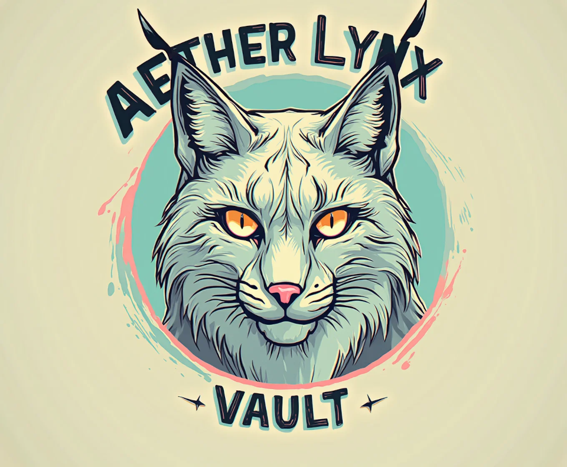

# AetherLynx SDK · Vault



Almacén de secretos en SQLite, cifrado con AES-256-GCM. El núcleo está en Rust y se usa desde Python.

## Cómo protege los secretos

- **Clave derivada, no guardada.** La clave se deriva de una passphrase con Argon2id (64 MiB, 3 pasadas). La sal y los parámetros se guardan en la tabla `vault_meta`; la passphrase y la clave, nunca. La misma passphrase reabre el vault tras un reinicio.
- **Passphrase incorrecta detectada.** Un valor de control cifrado ("canario") permite rechazar una passphrase equivocada sin tocar los datos.
- **Cada secreto ligado a su nombre.** El nombre se usa como datos autenticados (AAD): copiar el ciphertext de un secreto en otra fila hace fallar el descifrado.
- **Nonce aleatorio de 96 bits** por cada cifrado.
- **Rotación.** `change_passphrase()` vuelve a cifrar todos los secretos con una clave nueva en una sola transacción. Si otro proceso tiene el vault abierto, sus operaciones fallan con `StaleVaultError` en vez de escribir con la clave vieja; reábralo con la passphrase nueva. Los tokens de `encrypt()` viven fuera del vault y **no** se re-cifran: descífrelos antes de rotar.
- **Parámetros acotados.** Argon2id exige al menos 19 MiB y 2 pasadas (mínimo de OWASP) y como máximo 4 GiB, 10 pasadas y 16 hilos, también al leerlos de la base: un archivo manipulado no puede forzar a reservar memoria sin límite.

## Compilar

```bash
pip install maturin
maturin develop --release
```

## Uso

```python
import rust_vault

# La passphrase viene del entorno o de su gestor de secretos, nunca del código.
vault = rust_vault.RustVault.from_env("secrets.db")   # lee AETHERLYNX_VAULT_PASSPHRASE
# o: rust_vault.RustVault("secrets.db", passphrase)

vault.add_secret("db/password", "...")      # crea o actualiza
vault.get_secret("db/password")
vault.list_secrets()
vault.delete_secret("db/password")          # True si existía

token = vault.encrypt(b"datos", context="facturas")
vault.decrypt(token, context="facturas")    # el contexto debe coincidir

cert = vault.generate_certificate("api.example.com", days=90, store_key_as="tls/api/key")
cert["certificate_pem"], cert["private_key_pem"]

vault.change_passphrase("nueva passphrase larga")
```

Excepciones: `WrongPassphraseError`, `SecretNotFoundError`, `InvalidInputError`, `DecryptionError`, `StaleVaultError`, `LegacyVaultError`; todas heredan de `VaultError`.

Demostración: `AETHERLYNX_VAULT_PASSPHRASE='...' python main.py`. Ejecútela dos veces: los secretos siguen ahí.

## Pruebas

```bash
cargo test
pip install pytest && pytest -q tests
```

## Migración desde la versión 0.1

La 0.1 generaba una clave aleatoria en cada arranque y no la guardaba, así que sus secretos no se pueden descifrar. La 0.2 detecta esas bases (`LegacyVaultError`) y no las modifica. Cree un archivo nuevo, vuelva a cargar los secretos desde su origen y **rote cualquier credencial** que haya pasado por la base anterior.
